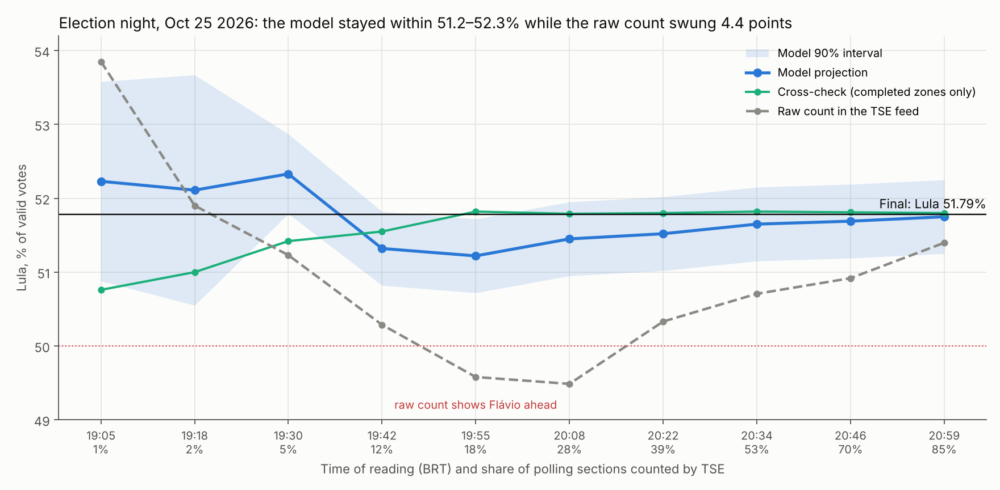
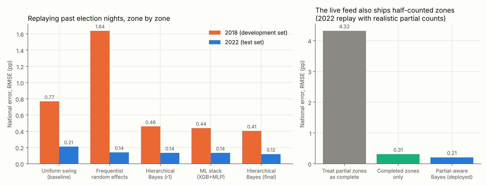

# Calling Brazil's 2026 runoff live from the official vote feed

**Gabriel Oliveira** · Machine Learning Scientist · M.Sc. in AI @ ITA · [LinkedIn](https://www.linkedin.com/in/gabriel-oliveira-ml) · [GitHub](https://github.com/GabrielSOliveir)

> **Election night, Oct 25 2026.** The raw count went from Lula ahead, to Flávio Bolsonaro ahead at 20:08, and back to Lula.
> Over the same period, this model's projection stayed between 51.2% and 52.3%. It finished at **51.75%** with 85% of
> sections counted. The official result was **51.79%**.



This repo covers the whole project, from a week of backtesting to a live run on election night. It contains the code,
the derived data, the dead ends, and one mistake I caught before it shipped.

| | |
|---|---|
| **Problem** | Project the final national result for Lula vs. Flávio from a partial, non-random count |
| **Data** | TSE (Brazil's electoral court) per-zone JSON feed with ~6,300 zones; 2018 and 2022 per-zone results; signed ballot-box bulletins (ASN.1) decoded before the official count opened |
| **Model** | Hierarchical Bayesian model (region → state → municipality → zone) of the swing from round 1 to round 2, with partially counted zones treated as biased, noisy measurements |
| **Live result** | Mean absolute error 0.32 pp over 10 readings (raw count: 1.25 pp); published intervals covered the final result 6 out of 7 times |
| **Backtest** | 0.21 pp national RMSE replaying 2022 with realistic partial counts (summing the feed naively: 4.3 pp) |
| **Stack** | Python (NumPy, SciPy, pandas, scikit-learn, XGBoost, PyTorch), a hand-written DER parser, browser JS for the live feed |

---

## 1. The problem: the early count is not a sample

Brazil counts about 470,000 electronic ballot boxes and publishes the running totals live. The early totals are not a
random sample. Some states and some sections within a zone report earlier than others, and they lean in a consistent direction. In 2022 the
raw count showed Bolsonaro ahead until 68% of sections were in. The question was how early the final number
could be called, and how confidently.

The key insight came from the problem's structure. Most people vote for the same candidate in both rounds. What moves
between rounds is where third-party, blank and null voters go, and who turns out. So the model **predicts the swing
from round 1 in each zone**, not the level of the vote. Round 1 is already known for every zone, so each zone has a
strong baseline. The model only has to learn how the swing varies across the country.

## 2. A research harness with specialist agents ([docs/01-research-harness.md](docs/01-research-harness.md))

I ran the research as a small, structured competition. A **lead agent** kept a shared knowledge base and set each
round's priorities. Four **specialist agents** (frequentist, Bayesian, ML, time series) each built models against the
same evaluator. All of this ran with Claude Code. The rules were fixed and the leaderboard was append-only. The
evaluator replays past election nights zone by zone under several arrival orders: the real one, random, geographic,
and adversarial.



What the four rounds established:

- **Anchoring on round 1 plus geographic partial pooling gives almost all of the gain.** XGBoost/MLP stacked on the
  residuals added only 1–5%, so they stayed out of the headline number.
- **ARIMA, Kalman trends, GRU and LSTM gave no gain.** The order of arrival carries no signal beyond what the hierarchy
  already captures, and these models extrapolated noise.
- **Robustness across elections mattered more than fit on any one.** The frequentist random-effects model was the best on 2022
  and the worst on 2018, with intervals covering 5% of the time. 2018 became the development set and 2022 the held-out test.
- **Leakage check.** The first ML stack topped the board on both years. That was because one feature had been
  fit on the final result of the year being evaluated. After the fix it scored 0.14 pp, the same as everything else.
  This led to a harness rule: history features must come only from *earlier* elections.
- **The biggest risk was the data feed, not the model.** A reviewer agent found that the live feed totals *sections*, so
  early in the night almost no zone is complete. A model that waits for complete zones has nothing to use; one that
  sums partial zones as if they were final is off by 4.3 pp. Round 3 rebuilt the evaluator to simulate partial counts,
  calibrated to TSE's official 2022 counting curve. The deployed model treats each partial zone as a noisy measurement
  whose bias is estimated from how that zone's numbers change between readings.
- **Two ideas the data rejected.** "Places that swung a lot before will swing a lot again": correlation 0.02 between
  2018 and 2022. "Neighbouring areas think alike": true at short range (0.32 below 0.5 km, about 0 beyond 5 km).
  Over 65k geocoded polling places, it reduced zone-level error by 1–3% and had no measurable effect nationally
  ([`research/`](research/)).

## 3. Election night ([docs/02-election-night.md](docs/02-election-night.md))

The container running the model could not reach TSE's servers. So the feed was read in a browser with a small JS
client ([`tse/tse_feed.js`](tse/tse_feed.js)), using incremental reads with backoff because the server returned 429 under load. Each reading was saved as a
snapshot and fed to [`live/live.py`](live/live.py). Before any number went out, it had to pass a publish gate:

1. Duplicate-snapshot detection, because re-reading the same feed would reset the model's per-zone history.
2. A **completed-zones-only cross-check**, run in parallel. A number was published only when both intervals overlapped.
3. A minimum interval half-width of ±0.5 pp while more than 30% of the votes came from partial zones.
4. No winner called while 50% was inside the interval.

| Time | TSE counted | Raw count | **Model** (90% interval) | Completed-zones check |
|---|---|---|---|---|
| 19:42 | 12% | 50.29 | **51.32** (50.82–51.82), first published | 51.55 |
| 20:08 | 28% | 49.49, Flávio ahead | **51.45** (50.95–51.95) | 51.79 |
| 20:34 | 53% | 50.71 | **51.65** (51.15–52.15) | 51.82 |
| 20:59 | 85% | 51.40 | **51.75** (51.25–52.25) | 51.80 |
| Final | 100% | | | **51.79** |

**Before the count opened.** Voting hours were extended to 19:00 and TSE held the totals until then, but signed
bulletins from closed sections were already public. A hand-written DER decoder ([`tse/bu_decoder.py`](tse/bu_decoder.py),
unit-tested on a real bulletin) read 860 of them at 17:07; projected with the same swing model, they pointed to 51.1–51.3%.

**Where it went wrong.** Between 19:42 and 20:22 the main model sat 0.3–0.5 pp below the final. The partial-zone
correction under-corrected for the way São Paulo reported, with its early sections leaning toward Flávio. The
completed-zones cross-check held 51.8% from 19:55 onward. One published interval, at 19:55, missed the final by 0.07 pp.
The lesson is in the docs: give the cross-check weight in the estimate once enough zones are complete, not only a veto.

## 4. What I'd do differently

1. **Model sections, not zones.** Bulletins are published per section during the count. A section-level model would
   remove most of the within-zone bias that cost 0.3–0.5 pp mid-evening.
2. **Blend the cross-check in, instead of using it only as a gate.** It was the more accurate estimate from 18% counted onward.

## Reproduce

```bash
pip install -r requirements.txt
python -m pytest tests/                                                   # DER decoder on a real bulletin
python harness/evaluate2.py harness/models/r2_bayes_final_dint.py --ano 2018   # complete-zone backtest
python harness/evaluate3.py harness/models/r3_domingo.py --ano 2022             # partial-count backtest -> 0.209 pp
python live/replay.py                                                      # re-runs election night from the 10 saved feed snapshots (~1 min, matches the log exactly)
python figures/make_figures.py
```

Everything runs from the repo root on the data in `data/`. The replay reproduces every number in the election-night table exactly.
The neighbourhood experiments in `research/` need the raw TSE polling-place files (several GB); [`data/README.md`](data/README.md) lists the sources.

## Repo map

```
harness/   evaluators (complete-zone, partial-count), 30 model files from 3 rounds, leaderboards (JSONL, append-only)
live/      election-night runner with the publish gate
tse/       browser client for the live feed, DER decoder for ballot-box bulletins
research/  neighbourhood-similarity experiments (polling-place geocoding, live pooling simulation)
data/      2018/2022 TSE per-zone tables, 2026 per-zone results, live snapshots and projection log
docs/      the long version of chapters 2 and 3
figures/   make_figures.py and its output
```

*Notes:* code comments and some variable names are in Portuguese (`zona` = zone, `secao` = polling section,
`virada` = swing, `apurado` = counted). The research harness was run with AI coding agents (Claude Code). I set the
questions, the rules and the decisions, and every number in this README comes from scripts in this repo.

---

**About the author.** Gabriel Oliveira is a machine learning scientist working on Bayesian forecasting, LLM agents and
SAR remote sensing, and an M.Sc. candidate in AI at the Instituto Tecnológico de Aeronáutica (ITA).
[LinkedIn](https://www.linkedin.com/in/gabriel-oliveira-ml) · [Other projects](https://github.com/GabrielSOliveir)
